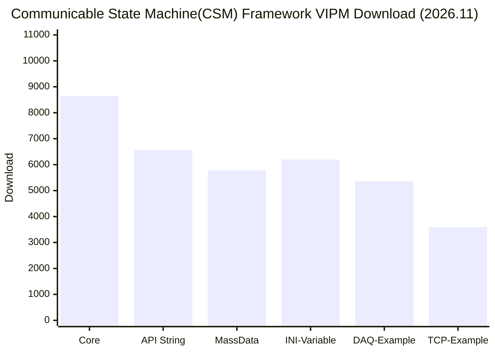

# CSM Framework 详解

本页是 [NEVSTOP-LAB 组织主页](./profile/README.md) 的详细内容：框架组成、DSH 工具链、自动统计与生态入口。标「自动更新」的区块由 [`update-profile-readme.yml`](./.github/workflows/update-profile-readme.yml) 每日北京时间 00:00 刷新。

## 🏗️ 框架组成

**CSM Framework 目标是成长为一个多语言支持的测试系统基础框架**

1. LabVIEW CSM Framework 作为基础长期维护，并拓展到 C#, python 等  
[Core](https://github.com/NEVSTOP-LAB/Communicable-State-Machine)
| [API-String](https://github.com/NEVSTOP-LAB/CSM-API-String-Arguments-Support)
| [MassData](https://github.com/NEVSTOP-LAB/CSM-MassData-Parameter-Support)
| [INI-Variable](https://github.com/NEVSTOP-LAB/CSM-INI-Static-Variable-Support)
2. VSCode 插件: [csm-vsc-extension](https://github.com/NEVSTOP-LAB/csm-vsc-extension)
3. LabVIEW 插件: [mermaid Tool](https://github.com/NEVSTOP-LAB/CSM-Mermaid-Plugin)
4. 应用场景的案例展示:
[数据采集](https://github.com/NEVSTOP-LAB/CSM-Continuous-Meausrement-and-Logging)
| [TCP通讯](https://github.com/NEVSTOP-LAB/CSM-TCP-Router-App)
| [Web服务器应用](https://github.com/NEVSTOP-LAB/G-Web-Development-with-CSM)

按主题分组的仓库索引：[CSM Framework](./Group-Communicable%20State%20Machine%28CSM%29%20Framework.md) · [Libraries](./Group-Libraries.md) · [Programming Environments](./Group-Programming%20Environments.md) · [Supplement of Base Functions](./Group-Supplement%20of%20Base%20Functions.md)

## 🧰 DeepSeek Harness (DSH)

DeepSeek Harness(DSH) 是本组织维护的插件化开发运行时：编辑、命令、审批、告警与测试流程收在同一个会话界面，能力通过插件扩展。组织在 CSM 之上提供 LabVIEW / Python / C# 的智能自动化测试方案。

- [awesome-dsh-plugin](https://github.com/NEVSTOP-LAB/awesome-dsh-plugin) — DSH 插件精选列表
- [labview-mcp](https://github.com/NEVSTOP-LAB/labview-mcp) — 让开发会话直接驱动 LabVIEW 的 MCP 服务
- [dsh-approval-mode](https://github.com/NEVSTOP-LAB/dsh-approval-mode) / [dsh-gfm-alerts](https://github.com/NEVSTOP-LAB/dsh-gfm-alerts) / [dsh-import-copilot-files](https://github.com/NEVSTOP-LAB/dsh-import-copilot-files) — 审批模式、GitHub 提示块、配置导入等常用插件

## 📈 VIPM 下载量

<!-- VIPM_DOWNLOADS_START -->

最近 24 个月历史数据（VIPM 安装量）

| 月份 | Core | API String | MassData | INI-Variable | DAQ-Example | TCP-Example | 合计 |
| --- | ---: | ---: | ---: | ---: | ---: | ---: | ---: |
| 2026.11 | 8646 | 6574 | 5775 | 6197 | 5358 | 3597 | 36147 |
| 2026.10 | 8442 | 6436 | 5667 | 6074 | 5239 | 3524 | 35382 |
| 2026.09 | 8080 | 6134 | 5449 | 5787 | 4979 | 3377 | 33806 |
| 2026.08 | 7727 | 5891 | 5185 | 5558 | 4747 | 3202 | 32310 |
| 2026.07 | 7328 | 5673 | 4918 | 5343 | 4484 | 2989 | 30735 |
| 2026.06 | 6917 | 5388 | 4570 | 5071 | 4173 | 2742 | 28861 |
| 2026.05 | 6538 | 5050 | 4260 | 4752 | 3914 | 2501 | 27015 |
| 2026.04 | 6142 | 4736 | 3956 | 4445 | 3678 | 2271 | 25228 |
| 2026.03 | 5708 | 4379 | 3605 | 4097 | 3441 | 2024 | 23254 |
| 2026.02 | 5434 | 4148 | 3395 | 3884 | 3246 | 1876 | 21983 |
| 2026.01 | 5253 | 3986 | 3247 | 3734 | 3112 | 1776 | 21108 |
| 2025.12 | 4964 | 3756 | 3039 | 3514 | 2905 | 1622 | 19800 |
| 2025.11 | 4792 | 3609 | 2900 | 3371 | 2773 | 1521 | 18966 |
| 2025.10 | 4592 | 3451 | 2753 | 3225 | 2635 | 1422 | 18078 |
| 2025.09 | 4415 | 3306 | 2620 | 3084 | 2503 | 1332 | 17260 |
| 2025.08 | 4128 | 3068 | 2411 | 2852 | 2298 | 1203 | 15960 |
| 2025.07 | 3687 | 2699 | 2064 | 2533 | 1974 | 1019 | 13976 |
| 2025.06 | 3264 | 2355 | 1840 | 2269 | 1759 | 801 | 12288 |
| 2025.05 | 2910 | 2117 | 1654 | 1998 | 1573 | 612 | 10864 |
| 2025.04 | 2593 | 1851 | 1503 | 1753 | 1423 | 454 | 9577 |
| 2025.03 | 2350 | 1653 | 1374 | 1559 | 1308 | 334 | 8578 |
| 2025.02 | 2056 | 1407 | 1218 | 1324 | 1091 | 189 | 7285 |
| 2025.01 | 1797 | 1241 | 1061 | 1128 | 951 | 72 | 6250 |
| 2024.12 | 1590 | 1074 | 945 | 974 | 813 | 0 | 5396 |

<!-- 更早的 7 个月快照（数据保留，默认不显示）：2024.11 到 2024.05
| 2024.11 | 1412 | 929 | 807 | 837 | 704 | 0 | 4689 |
| 2024.10 | 1255 | 821 | 703 | 730 | 604 | 0 | 4113 |
| 2024.09 | 1101 | 703 | 621 | 615 | 532 | 0 | 3572 |
| 2024.08 | 987 | 617 | 565 | 531 | 461 | 0 | 3161 |
| 2024.07 | 887 | 541 | 512 | 459 | 402 | 0 | 2801 |
| 2024.06 | 776 | 459 | 435 | 387 | 369 | 0 | 2426 |
| 2024.05 | 698 | 412 | 402 | 341 | 344 | 0 | 2197 |
-->
<!-- VIPM_DOWNLOADS_END -->

_每日由github action自动更新_

## 🧩 CSM 可复用模块 (CSM Modsets)

<!-- CSM_MODSETS_START -->
<pre>
<a href="https://github.com/NEVSTOP-LAB">NEVSTOP-LAB</a> (9)
  <a href="https://github.com/NEVSTOP-LAB/CSMScript-Lite">CSMScript-Lite</a> ⭐33 CSMScript Lite版本，一款轻量级脚本执行引擎，用于执行灵活的 CSM 测试脚本
  <a href="https://github.com/NEVSTOP-LAB/CSM-TCP-Router-App">CSM-TCP-Router-App</a> ⭐11 Application Example to show how to setup a TCP Server and Client using CSM and JKI TCP Server.
  <a href="https://github.com/NEVSTOP-LAB/CSM-Modsets-WaveformDisplay">CSM-Modsets-WaveformDisplay</a> ⭐10 CSM 模块: 显示 Waveform
  <a href="https://github.com/NEVSTOP-LAB/CSM-ModSets-SplashWindow">CSM-ModSets-SplashWindow</a> ⭐8 CSM Module: Splash Window
  <a href="https://github.com/NEVSTOP-LAB/CSM-ModSets-FileSync">CSM-ModSets-FileSync</a> ⭐8 基于 CSM 的文件同步模块
  <a href="https://github.com/NEVSTOP-LAB/.github/blob/HEAD/csm-modsets.md#NEVSTOP-LAB">更多请查看 csm-modsets.md</a>

<a href="https://github.com/nevstop">nevstop</a> (2)
  <a href="https://github.com/nevstop/CSM-Modsets-SimWaveform">CSM-Modsets-SimWaveform</a> ⭐8 CSM Module: 模拟波形
  <a href="https://github.com/nevstop/CSM-Utils">CSM-Utils</a> ⭐6 复用VI，还未被纳入到CSM的安装包中

<a href="https://github.com/datadataup">datadataup</a> (1)
  <a href="https://github.com/datadataup/CSM-MDI-ViewManager">CSM-MDI-ViewManager</a> ⭐10 基于LabVIEW CSM框架下的MDI模块，运行时对页面进行自定义布局管理

<a href="https://github.com/LiXinxing77">LiXinxing77</a> (2)
  <a href="https://github.com/LiXinxing77/CSM-Modsets-Grouped-UI">CSM-Modsets-Grouped-UI</a> ⭐5 一种可以分组折叠的导航界面
  <a href="https://github.com/LiXinxing77/CSM-Modsets-Curve-Editor">CSM-Modsets-Curve-Editor</a> ⭐3 一个CSM框架的曲线编程器，同时也保留了QHM框架的程序可供对比
</pre>
<!-- CSM_MODSETS_END -->

_每日扫描 github [csm-modsets](https://github.com/search?q=topic%3Acsm-modsets&type=repositories) topics更新，更多信息查看 [csm-modsets.md](https://github.com/NEVSTOP-LAB/.github/blob/HEAD/csm-modsets.md)_

## 👩‍💻 Sorted By Topics

<!-- SORTED_TAGS_START -->
[`labview(66)`](https://github.com/search?q=topic:labview%20org:NEVSTOP-LAB%20is:public&type=Repositories)
[`labview-csm(27)`](https://github.com/search?q=topic:labview-csm%20org:NEVSTOP-LAB%20is:public&type=Repositories)
[`vipm(15)`](https://github.com/search?q=topic:vipm%20org:NEVSTOP-LAB%20is:public&type=Repositories)
[`cicd(13)`](https://github.com/search?q=topic:cicd%20org:NEVSTOP-LAB%20is:public&type=Repositories)
[`lvcicd(11)`](https://github.com/search?q=topic:lvcicd%20org:NEVSTOP-LAB%20is:public&type=Repositories)
[`example(10)`](https://github.com/search?q=topic:example%20org:NEVSTOP-LAB%20is:public&type=Repositories)
[`csm-modsets(9)`](https://github.com/search?q=topic:csm-modsets%20org:NEVSTOP-LAB%20is:public&type=Repositories)
[`framework(8)`](https://github.com/search?q=topic:framework%20org:NEVSTOP-LAB%20is:public&type=Repositories)
[`labview-library(8)`](https://github.com/search?q=topic:labview-library%20org:NEVSTOP-LAB%20is:public&type=Repositories)
[`python(8)`](https://github.com/search?q=topic:python%20org:NEVSTOP-LAB%20is:public&type=Repositories)
[`dsh(6)`](https://github.com/search?q=topic:dsh%20org:NEVSTOP-LAB%20is:public&type=Repositories)
[`dsh-plugin(6)`](https://github.com/search?q=topic:dsh-plugin%20org:NEVSTOP-LAB%20is:public&type=Repositories)
[`jkism(6)`](https://github.com/search?q=topic:jkism%20org:NEVSTOP-LAB%20is:public&type=Repositories)
[`application(5)`](https://github.com/search?q=topic:application%20org:NEVSTOP-LAB%20is:public&type=Repositories)
[`deepseek-harness(5)`](https://github.com/search?q=topic:deepseek-harness%20org:NEVSTOP-LAB%20is:public&type=Repositories)
[`ai(4)`](https://github.com/search?q=topic:ai%20org:NEVSTOP-LAB%20is:public&type=Repositories)
[`html(4)`](https://github.com/search?q=topic:html%20org:NEVSTOP-LAB%20is:public&type=Repositories)
[`javascript(4)`](https://github.com/search?q=topic:javascript%20org:NEVSTOP-LAB%20is:public&type=Repositories)
[`template(4)`](https://github.com/search?q=topic:template%20org:NEVSTOP-LAB%20is:public&type=Repositories)
[`environments(3)`](https://github.com/search?q=topic:environments%20org:NEVSTOP-LAB%20is:public&type=Repositories)
[`lv-csm-app(3)`](https://github.com/search?q=topic:lv-csm-app%20org:NEVSTOP-LAB%20is:public&type=Repositories)
[`ui(3)`](https://github.com/search?q=topic:ui%20org:NEVSTOP-LAB%20is:public&type=Repositories)
[`vip(3)`](https://github.com/search?q=topic:vip%20org:NEVSTOP-LAB%20is:public&type=Repositories)
[`vscode(3)`](https://github.com/search?q=topic:vscode%20org:NEVSTOP-LAB%20is:public&type=Repositories)
[`archived(2)`](https://github.com/search?q=topic:archived%20org:NEVSTOP-LAB%20is:public&type=Repositories)
[`base-function(2)`](https://github.com/search?q=topic:base-function%20org:NEVSTOP-LAB%20is:public&type=Repositories)
[`c(2)`](https://github.com/search?q=topic:c%20org:NEVSTOP-LAB%20is:public&type=Repositories)
[`cordis(2)`](https://github.com/search?q=topic:cordis%20org:NEVSTOP-LAB%20is:public&type=Repositories)
[`daq(2)`](https://github.com/search?q=topic:daq%20org:NEVSTOP-LAB%20is:public&type=Repositories)
[`exe(2)`](https://github.com/search?q=topic:exe%20org:NEVSTOP-LAB%20is:public&type=Repositories)
[`github-actions(2)`](https://github.com/search?q=topic:github-actions%20org:NEVSTOP-LAB%20is:public&type=Repositories)
[`labview-xcontrol(2)`](https://github.com/search?q=topic:labview-xcontrol%20org:NEVSTOP-LAB%20is:public&type=Repositories)
[`national-instruments(2)`](https://github.com/search?q=topic:national-instruments%20org:NEVSTOP-LAB%20is:public&type=Repositories)
[`poc(2)`](https://github.com/search?q=topic:poc%20org:NEVSTOP-LAB%20is:public&type=Repositories)
[`quickdrop(2)`](https://github.com/search?q=topic:quickdrop%20org:NEVSTOP-LAB%20is:public&type=Repositories)
[`scss(2)`](https://github.com/search?q=topic:scss%20org:NEVSTOP-LAB%20is:public&type=Repositories)
[`shell(2)`](https://github.com/search?q=topic:shell%20org:NEVSTOP-LAB%20is:public&type=Repositories)
[`skills(2)`](https://github.com/search?q=topic:skills%20org:NEVSTOP-LAB%20is:public&type=Repositories)
[`tagdb(2)`](https://github.com/search?q=topic:tagdb%20org:NEVSTOP-LAB%20is:public&type=Repositories)
[`transformer(2)`](https://github.com/search?q=topic:transformer%20org:NEVSTOP-LAB%20is:public&type=Repositories)
[`typescript(2)`](https://github.com/search?q=topic:typescript%20org:NEVSTOP-LAB%20is:public&type=Repositories)
<!-- SORTED_TAGS_END -->

_每日自动扫描 NEVSTOP-LAB 公开仓库, 并根据 topics 分类更新；私有仓库不计入统计（例如 `archived` 只反映公开归档仓库数）_

## 🤖 AI-Wiki 机制

**AI-Wiki 机制, 自动收集更新 CSM 信息** → [CSM-Wiki Website](https://nevstop-lab.github.io/CSM-Wiki/)

- 由 AI 负责整理和更新 CSM 相关文档，确保信息的及时性和准确性 [CSM Wiki Repo](https://github.com/NEVSTOP-LAB/CSM-Wiki)
- [Discussion:Q&A分组](https://github.com/orgs/NEVSTOP-LAB/discussions/categories/q-a?discussions_q=) 中的问题，会得到 CSM-AI-Robot 的回复(deepseek-v4-pro)
